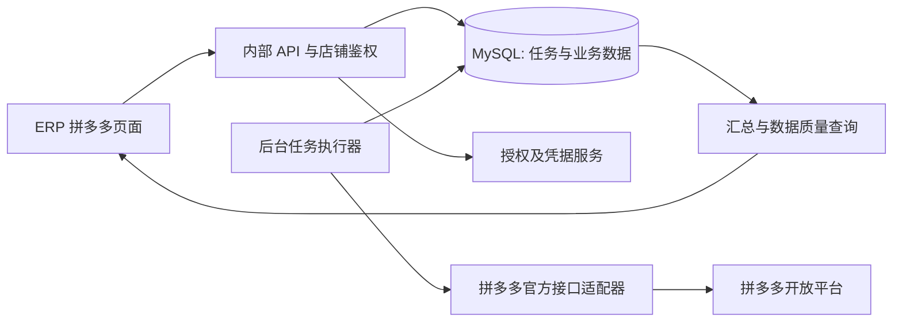

# 拼多多官方接入与同步架构

关联：[数据模型](03-data-model.md)、[实施与验收](05-delivery-and-acceptance.md)。

## 1. 官方来源和核验状态

- 官方入口：[拼多多开放平台](https://open.pinduoduo.com/)。
- 文档入口：[开放平台 API 文档](https://open.pinduoduo.com/application/document/api)。

2026-10-12 上述页面返回动态网页外壳，未取得具体 API 文档。本文不确认任何远端 method 名、签名算法、OAuth 参数、额度或商家准入条件。开发人员必须在应用控制台记录实际文档页面链接、核验日期、版本、必要权限和脱敏请求/响应样例。

不能用多多进宝/推广能力替代商家订单与商品发布能力。

## 2. 从零申请与接入流程

1. 确认申请主体、营业资质、联系人和首批店铺负责人；按官方当前入口选择能支持自有/授权商家 ERP 的应用类型。
2. 核对是否需要服务商资质、软件审核、商家订购或其他准入条件，不把「创建应用」视为已获全部接口权限。
3. 登记生产应用与允许的开发测试方式，配置官方要求的回调域名/URL，提交订单、售后、商品读取和发布能力申请。
4. 取得 client 标识与 secret 后仅在后端密钥存储配置；UI 显示掩码、状态和版本，不返回明文 secret。
5. 核验授权时效、续期方式、撤销行为、是否支持 refresh token。仅在确认存在续期接口时实现自动刷新，否则提示商家重新授权。
6. 对一家授权店做只读小窗口调用，核对真实店铺 ID、分页、状态、金额单位、时间字段。
7. 在官方允许的测试环境或获业务明确确认的真实测试店，用一个合规商品验证发布、审核和链接获取。
8. 归档核验矩阵与证据后，分阶段放开多店同步和发布。

应用审批等待期可以先开发任务、映射、导入和内部接口，用替身测试；不能据此宣称真实接入已完成。

## 3. 能力矩阵（远端实现前必填）

| 能力 | 官方方法与文档链接 | 权限/资质 | 待核验契约 | 未获能力时 |
| --- | --- | --- | --- | --- |
| 授权与店铺身份 | 待核验 | 待核验 | 回调、state 支持、店铺 ID、过期/续期 | 禁止 API 任务 |
| 订单列表/详情 | 待核验 | 待核验 | 支付/更新时间、可查范围、分页、隐藏字段 | 官方订单文件导入 |
| 售后/退款 | 待核验 | 待核验 | 售后 ID、退款完成、累计/事件金额、增量字段 | 官方售后文件导入 |
| 商品与 SKU | 待核验 | 待核验 | 商品 ID、规格、价格、库存、下架与删除 | 官方商品文件导入或人工映射 |
| 类目/属性/规格 | 待核验 | 待核验 | 店铺可用类目、必填属性、资质、缓存失效 | 人工整理，禁用自动发布 |
| 图片素材 | 待核验 | 待核验 | 上传方式、来源 URL、格式、限制、有效期 | 输出素材包 |
| 运费/承诺模板 | 待核验 | 待核验 | 店铺模板及必填经营字段 | 人工后台发布 |
| 商品创建/提交 | 待核验 | 待核验 | 创建还是审核受理、幂等键、外部任务 ID | 草稿资料包 |
| 发布结果/审核/链接 | 待核验 | 待核验 | 查询方法、状态、真实链接、结果关联 | 人工核实绑定，阻断自动重发 |

每项同时记录频次/并发上限、最大窗口、最大分页、历史保留期、重试条件、错误码和金额语义。能力标为 verified_supported / verified_unsupported / pending_verification，不用空白表示默认支持。每家店记录实测权限，应用有权限不代表所有店铺可用。

## 4. 架构与职责

Java 包 com.bebefish.erp.pdd 下设 api、application、domain、infrastructure。外部 SDK 若官方提供且版本可用再选用；否则以官方签名/传输契约实现适配器。业务逻辑只依赖 PddOrderClient、PddAfterSaleClient、PddGoodsClient、PddPublishClient 等端口。

复用现有商品、文件与平台 application 查询接口，不从 pdd 服务直接改商品/库存/销售/发货表。尚缺的商品快照查询能力在 product 模块内增加。

首版 Spring 定时扫描 MySQL 队列，短事务领取任务，网络调用在事务外；分批事务保存结果。不得在持有行锁时等待平台网络。

## 5. 授权安全与并发

- 授权发起必须同时校验员工角色及店铺管理范围。
- OAuth state 若官方协议支持，使用不可预测随机值，数据库只存哈希，绑定发起用户、内部店铺、应用、有效期和一次性消费状态；若协议不支持，必须确定官方认可的等价关联/防重放方式后再实现。
- 回调不要求商家当前持有 ERP 登录，但必须校验关联上下文、一次性 code 消费、真实外部店铺 ID，拒绝不匹配绑定。按协议验证回调真实性。
- 店铺身份未确认前，新 token 放在短期加密候选记录中，不能替换已有有效授权。
- token 是调用凭据，必须可解密调用，不能只存哈希。采用受认证加密，例如 AES-GCM，保存 key_id、随机 nonce、ciphertext/tag，AAD 绑定应用/店铺/凭据类型。主密钥在部署密钥配置中，不入库、不入 Git。
- 刷新使用版本号、单店租约或行锁短事务，防止旧刷新覆盖新授权。任务领取授权 generation，提交结果时再次核验；不同外部店铺授权不能接管原任务。
- 不记录完整 token、code、secret、收件信息；代理访问日志过滤回调查询参数；回调后跳转干净 URL。
- 撤销/解绑立即禁止新远程调用，并使凭据不可用；历史事实保留。撤销已有运行中调用的最终结果仍需安全归档。

## 6. 同步算法与游标

默认初始回补最近 30 天；默认每 10 分钟订单/售后增量、每小时商品增量或分页巡检。以上是 ERP 配置初值，必须按官方实际额度、可查询范围和数据延迟调整。

1. 每个店铺、数据集拥有独立游标和最近完整成功窗口，锁定扫描上界 T。
2. 采用半开窗口 [start,end)，平台不同边界语义由适配器转换并本地去重。允许回退 10 分钟重叠读取，不能依赖时间戳唯一。
3. 按平台允许的窗口分段，每个固定窗口遍历所有分页/官方 continuation token。分页变化、结果达到最大上限时细分窗口；无法穷尽时标记 incomplete，不推进成功游标。
4. 同时刻大量数据须遍历完全部页；不得只用更新时间 +1 秒推进导致遗漏。官方不能提供稳定排序时增加重叠重扫和日终对账。
5. 以外部稳定 ID 幂等保存；保存远端更新时间、payload hash、数据来源。晚到旧版本不覆盖新状态；时间同值且内容冲突记待核实，不推定“最后请求”一定最新。
6. 每页事实和检查点在同一短事务提交。整个窗口结束才原子推进完整成功游标；失败或停止后从检查点恢复并允许重读。
7. 订单与售后独立同步。售后先到时保留待关联，不丢弃，也不凭空生成已支付订单。
8. 数据变更写入待重算日期队列，支付事实变动重算支付日，退款变动重算退款日和关联订单支付日。
9. 近期 7 天建议日终重扫，未结束售后建议持续巡检；更早变动通过官方消息（若支持）或周期抽样/回补。历史能力不足时声明缺口。

若官方没有有效的修改时间筛选，不能假装存在增量：使用允许的时间列表 + 非终态 ID 回查 + 周期全量商品巡检。只有已付创建时间列表不足以保证退款和取消状态完整。

## 7. 队列、限流和故障恢复

任务租约包含 owner、lease_until、heartbeat、attempt、fencing_token。领取时原子增加 fencing_token，提交进度须匹配当前租约代次；过期 Worker 不得覆盖新执行结果。job parent 由 child 状态推导。

限流作用于应用总额及店铺/API 维度；配置从核验矩阵加载。首版少量店可单执行实例，MySQL 记录额度保守分配；多实例必须启用共享限流状态，不能每实例各用完整额度。

| 情况 | 处理 |
| --- | --- |
| 读取网络异常/平台暂时错误 | 指数退避+抖动，最多 5 次（可配置），记录失败窗口 |
| 限流 | 尊重官方等待信息并延迟，降低并发，不当作授权失效 |
| 授权过期/撤销 | 暂停店铺任务，标 needs_reauth，不无限重试 |
| 参数/权限/资质错误 | 明确失败，指向修复字段或缺失能力 |
| 发布明确受理 | 存外部 ID，转 awaiting_result / succeeded 并独立回读审核 |
| 发布超时/响应不可解析/崩溃于发送后 | unknown，启动结果核实，禁止自动重新发送创建 |
| unknown 无查询关联能力 | manual_resolution，授权人员提供核实证据，不按等待时长判定失败 |

发布只有官方确认支持稳定幂等键时才可使用原键安全重发。否则先核验结果，确认未创建后经人工确认新尝试。取消只阻止尚未发送任务；发送后的商品撤回属于其他业务动作。

## 8. 文件导入与来源优先级

仅支持管理员核验的官方导出模板版本，先预览店铺、字段和数量，用户确认后入库。文件去重用 sha256，行按业务键去重，金额/状态/日期语义不明确即拒绝或标记待核验。禁用宏/外链/公式执行，限制大小、解压后容量、行数，失败行可下载。

导入不会推进 API 成功游标。相同业务键同一远端版本/API 确认可比时以 API 为准；不能比较版本时保留导入来源与冲突记录、要求核对，不让晚上传旧文件覆盖新事实。人工完成的商品发布必须经外部 ID 回读/人工证据绑定，不能标为「API 自动发布成功」。

## 9. 个人数据与运维

首版经营汇总无需完整收件人姓名、电话和地址；默认不采集。确有订单处理需求再申请必要能力、加密保存并分配敏感查看权限。原始响应也不成为绕过脱敏的存储入口。

建议脱敏诊断响应保留 7 天、导入原文件 30 天、任务与审核日志 180 天（发布前由公司政策及平台条款确认）；订单/售后事实按业务保存期管理，不随原文件过期删除。备份密文及独立密钥恢复方案并验证轮换。

拟定环境配置：ERP_PDD_ENABLED、ERP_PDD_WRITES_ENABLED（默认 false）、ERP_PDD_ENVIRONMENT、ERP_PDD_CALLBACK_BASE_URL、ERP_PDD_CREDENTIAL_KEY_ID、ERP_PDD_CREDENTIAL_KEY。官方地址、client 标识和 secret 由应用记录及部署配置管理，不在本文填写真实值。测试替身只用于 local/test，prod 禁止伪造授权或发布成功。
