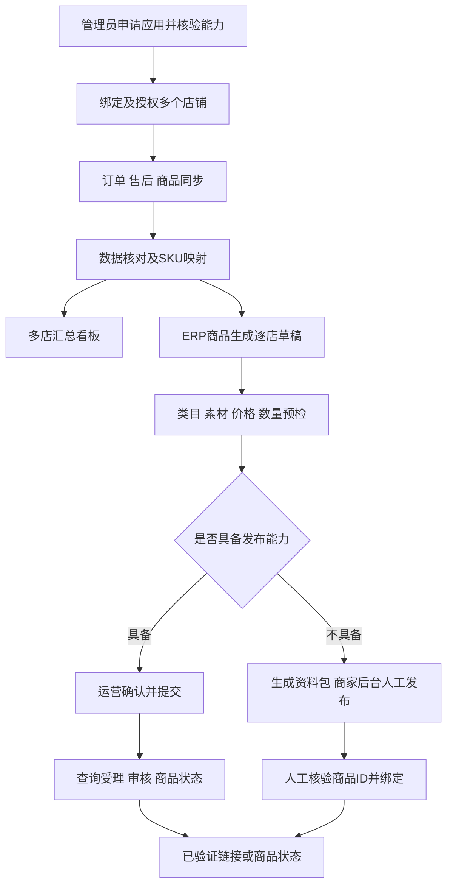

# 拼多多多店铺运营中心：产品方案

版本：0.1，2026-10-13。本文面向运营、负责人和开发评审，配合 [开发文档索引](00-overview.md) 使用。

店铺管理的页面、分组、多选与数据明细交互细化见 [参考狗宝助手的店铺与商品管理 PRD](08-goubao-shop-product-prd.md)。该文档区分实际观察到的竞品功能与 ERP 建议设计，新增分组范围需纳入实施估算。

## 1. 产品定位

在现有 BeBefish ERP 中增加「拼多多运营」模块，让运营在一处查看多个拼多多店铺的订单、售后、商品及销售汇总，并把ERP商品资料转为逐店发布草稿。

第一版解决「看全数据、看清差异、减少重复录入」。统计和发布共用店铺与商品身份，但分阶段交付。拼多多API有能力限制时，提供官方文件导入和发布资料包，清楚区分自动接入与人工处理。

## 2. 用户目标与价值

| 用户 | 当前问题 | 本产品提供 |
| --- | --- | --- |
| 老板/负责人 | 多店经营数据分散，退款跨期后报表难解释 | 统一口径看板、分店排名、完整性提示 |
| 分店运营 | 到多个后台查订单/售后，授权失效难发现 | 按店查询、售后关联、同步状态和异常处理 |
| 商品人员 | 重复录入标题、图片、SKU和规格，店铺字段不一致 | ERP选品生成草稿、逐店字段覆盖与最终预览 |
| 管理员 | 多账户权限与任务难追踪 | 店铺绑定、授权能力、范围权限和任务审计 |

商品发布成功并不意味着有流量、成交或利润。第一版成功依据是资料准确、任务可追溯、结果可信和少重复工作。

## 3. 信息架构与页面方案

### 3.1 经营总览

顶部：时间范围、日期口径、店铺多选、数据截止及刷新状态。

指标：支付订单数、支付金额、客单价、当期成功退款额、当期净支付；切换支付批次后展示累计退款及累计净额。数据缺失时该卡片说明缺口，不能填零。

主体：支付/退款趋势、分店对比、商品/SKU排名、待处理异常摘要。点击店铺或商品跳到保持日期与店铺条件的列表。

页脚：口径说明与完整性，查看对应对账记录。无广告/成本数据时不提供虚假的利润卡片。

### 3.2 店铺连接

列表：店铺名、实际外部店铺身份、负责人、授权状态/到期、订单/售后/商品/发布能力、最近完整同步、异常数量。

操作：绑定现有店铺、授权/重授权、计划设置、手动同步、查看任务、成员设置。创建店铺跳转现有平台管理，不在本页另建主数据系统。

首次使用显示三步引导：申请应用→授权店铺→首次同步。未取得发布能力时读取功能正常可用，发布按钮说明缺失能力，并可进入资料包流程。

### 3.3 订单和售后

订单按店、日期、状态、订单号筛选；金额与状态来自平台事实。详情显示商品明细、支付/退款、关联售后、来源与更新时间。默认不展示无业务必要的完整个人资料。

售后显示申请状态与成功退款，申请金额不作为实际退款。跨期退款可点开对应支付订单，解释其在不同报表中的归属。

不能直接编辑平台支付/退款事实；数据异常通过补数、文件核验和来源冲突处理解决。

### 3.4 商品及SKU映射

平台商品列表显示店铺、商品ID、标题、状态、平台库存、SKU和ERP映射。商品状态需标采集时间；平台库存独立于ERP实物库存。

映射抽屉对照外部SKU与ERP SKU，显示编码/规格并人工确认。不根据名称自动覆盖，未映射也不丢弃销售总额。

### 3.5 商品上链接

从ERP商品详情增加「生成拼多多草稿」入口，并在拼多多草稿页提供选品入口；都要求相关权限。

编辑器六步：选择商品/目标店铺→类目与属性→图片与描述→SKU价格和发布数量→模板与资质→逐店预览。

各店共享ERP来源快照，可单独覆盖标题、价格、素材、类目与数量。店铺模板和资质不能直接复制给其他店。来源商品修改时显示新版本提示，由用户选择刷新草稿，已冻结提交版本不变。

最终预览每店一行：标题、类目、SKU数、价格范围、数量、模板、资质、校验结果。批量预检有错时零提交，用户显式移除错误店后再次确认；提交中某店失败时独立处理。

发布结果明确分栏「提交结果」「平台状态」。审核拒绝显示可修正原因；unknown显示核实入口，避免重复上链接。真实链接无法取得时显示商品ID和商家后台入口，不伪造商品URL。

### 3.6 任务与数据质量

任务中心显示操作类型、目标店、发起人、时间、进度和子任务结果。以后台状态为准，浏览器关闭不终止服务端任务。

质量页显示授权缺口、失败窗口、缺失时间/金额、未映射和对账冲突，提供相应重新授权/补数/映射入口。原始日志不是运营默认入口，错误解释用业务语言。

## 4. 主流程

订单同步不会触发销售单生成、库存扣减或安能下单。以后需要自动发货和库存联动时，在单独产品方案中明确业务闭环和库存责任。

## 5. 首版产品取舍

| 选择 | 理由及代价 |
| --- | --- |
| 官方API为主、官方文件导入为补充 | 有效授权可持续同步；未开权限和历史范围不足时仍能阅读数据，来源需标注 |
| MySQL持久任务 | 与现有部署一致，重启可恢复；大规模吞吐再评估专用队列 |
| 分店草稿与独立结果 | 各店规则可不同，一店失败不丢其他结果；不能声称批量发布为跨平台原子事务 |
| 汇总与财务账分开 | 减少重复记账；首版支付额不能当作已到账或利润 |
| 人工分配发布数量 | 降低初期库存联动复杂度；不能承诺跨平台防超卖 |
| unknown先核实 | 避免远端已创建后再次上链接；部分情况需人工确认 |
| 范围权限后端校验 | 现有店铺负责人姓名不等于权限；新增授权范围维护成本 |

## 6. 产品里程碑与成功标准

| 里程碑 | 可演示结果 | 产品验收 |
| --- | --- | --- |
| M1 店铺可接入 | 两店独立授权、能力展示、任务页 | 不串店，失效可恢复，无法支持的能力有解释 |
| M2 数据可使用 | 两店订单/售后/商品、7天对账、看板 | 经同口径核验的金额精确到分，缺口可定位 |
| M3 单店可上链接 | 一个ERP商品到一家店铺的完整发布链 | 内容准确，提交/审核/上架分开，链接有证据 |
| M4 多店可推广 | 同商品多店草稿/差异预览/分店结果 | 重复点击不重复创建，部分失败与unknown可处理 |

若自动发布未获平台能力，M3/M4仅可验收资料包与人工绑定，不标成自动发布已完成。研发粗估与任务依赖见05文档，审批时间单独跟踪。

建议试运行指标：两店最近7天数据对账差异可解释；零重复发布；所有任务有明确结果或待核实状态；选择10个常用品类商品测量原后台录入与ERP草稿的中位耗时，记录是否改善。未经实测不承诺效率提升百分比。

## 7. 运营准备清单

| 事项 | 负责人类型 | 完成标志 |
| --- | --- | --- |
| 主体/应用/接口权限申请 | 系统管理员与店铺负责人 | 控制台能力和实测证据 |
| 首批两家店铺和成员范围 | 运营负责人 | 内部店ID、外部店ID、人员名单确认 |
| 初始历史范围和金额口径 | 运营与财务 | 7天官方订单/售后样例与字段解释 |
| 初期商品类目、资质、运费模板 | 商品/店铺运营 | 一个可合规发布商品的资料齐全 |
| SKU映射和发布数量 | 商品与仓库负责人 | 规格对应正确，各店人工数量方案 |
| unknown处理与人工发布 | 运营负责人 | 能到商家后台核实，记录证据与确认人 |

暂未确认店数、全部类目、发布商品量和真实权限；它们是后续实施输入，不影响本轮文档交付。第一批建议两店、一个商品跑通，验收后再扩展。
