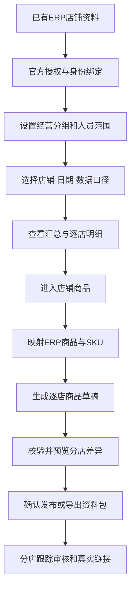

# 参考狗宝助手的店铺与商品管理产品需求文档

版本：0.2（产品评审稿）<br>
日期：2026-10-13<br>
目标产品：BeBefish ERP 拼多多运营模块<br>
参考产品：本地狗宝助手，界面显示版本 1.118<br>
关联：[总方案](07-product-proposal.md)、[原开发文档](00-overview.md)、[统计口径](06-metrics-and-quality.md)。

## 1. 本轮目标与用词

重点规划「店铺管理」，结合已确认的多店数据同步和“上链接”需求，配套规划「商品管理」。

用户已确认范围为“店铺管理 + 商品管理”。第4至8节为店铺管理，第9至11节为商品管理与上链接流程，均纳入本轮产品方案；商品部分的竞品实页观察仍需补充。

本稿补充产品页面、字段、操作与验收细节；与前面的架构、权限、金额、发布幂等原则一致。优先复用ERP现有平台/店铺目录，不新建另一套经营主体。

## 2. 实际参考记录与证据边界

### 2.1 已直接观察到

本次通过本地应用界面观察，未读取狗宝助手安装目录、账户文件、数据库、Cookie或私有接口，也未向外发送店铺经营数据。

| 页面位置 | 实际可见内容 | 证据范围 |
| --- | --- | --- |
| 顶部主菜单 | 用户首页、店铺管理、商品管理、客服管理、爆款分析、业务功能、AI工具、商务合作 | 菜单入口存在；不等于子功能已查看 |
| 店铺管理子导航 | 我的店铺、店铺数据汇总、店铺数据明细、推广统计、运营报表、商品分析、活动报名 | 仅确认入口文字 |
| 店铺数据明细 | 多店经营数据列表 | 实际读取了此页面 |
| 我的店铺 | 复选框、店铺账号、登录状态、店铺名称、店铺备注、店铺ID、主营类目、上货到期、推广助手功能到期、运费模板 | 用户手动切换后实际读取；账号、ID及具体资料不复制 |
| 我的店铺工具栏 | 获取云端店铺、添加/登录店铺、检测登录状态、删除店铺、获取运费模板、购买店铺上货/推广助手、分组管理、排序管理、实时同步数据 | 仅确认入口；未执行登录、删除、购买或同步 |
| 我的店铺筛选和行内控件 | 店铺名称/店铺ID/店铺备注搜索、分组选择、可输入备注、运费模板下拉；店铺名称标注“点击可进入后台” | 仅观察控件；未修改备注、模板，也未进入商家后台 |
| 店铺筛选 | 店铺选择，显示已选择15个店铺；店铺分组，显示全部 | 看到了选择控件，未展开并核验规则 |
| 时间筛选 | 今天、昨天、7天、30天、起止日期 | 看到了控件，未验证查询边界 |
| 数据读取 | “读取统计”按钮 | 看到了入口，未执行数据采集 |
| 表格 | 一店一行、带排序图标的列头、横向多指标、底部合计行 | 看到了布局，未核验排序/汇总算法 |
| 可见指标 | 访客、订单数、转化率、交易额、客单价、ROI、退款率、待签收货款、账户余额、可用余额、保证金、提现金额/状态/时间 | 部分列名截断，成交/推广/退款相关具体字段未完整识别 |
| 行内入口 | 综合数据、商品品质 | 看到了入口，未进入明细 |
| 表格右上 | 下载样式和布局样式图标 | 图标用途未操作验证，不直接断言下载格式或列配置能力 |

真实店铺名称、销售金额、余额及账户信息不复制进产品文档；示例均使用“店铺A/B”和虚构数据。

### 2.2 未观察到与操作限制

早期自动点击“我的店铺”和“商品管理”后，页面仍保持店铺数据明细。用户手动切换后，已读取“我的店铺”。随后自动点击“分组管理”和“商品管理”，仍未看到弹窗或页面切换，原因未确认；不能据此判断产品没有对应功能。店铺添加/分组弹窗、商品列表、编辑器、上链接流程均未实际查看。

下文这些页面、字段与交互属于BeBefish ERP建议设计，不宣称狗宝助手已经采用。后续能切到实际页面时，再补充新的观察记录和差异。

## 3. 借鉴方向与首版范围

| 狗宝助手可见设计 | ERP产品决策 | 优先级 |
| --- | --- | --- |
| 店铺管理与商品管理主入口 | 使用ERP侧栏下的店铺中心、店铺商品、商品发布，概念分开 | P0 |
| 多店选择 + 分组 | 统一店铺选择器、经营分组、按权限显示 | P0 |
| 我的店铺资料、备注、主营类目 | 复用店铺目录，补充平台资料快照；内部备注与平台资料分开 | P0 |
| 登录状态、上货到期、推广助手到期分别列示 | ERP分别展示在用、授权、同步、发布能力；不将第三方订阅到期当作平台授权到期 | P0 |
| 获取运费模板及逐店模板选择 | 逐店发布配置引用已核验模板，发布前检查目标店适用性 | P0，官方能力依赖 |
| 排序管理入口 | 复用内部店铺排序；分店经营表仍按指标排序 | P1 |
| 时间快捷选择 | 今天/昨天/近7天/近30天/自定义，明确日期范围 | P0 |
| 一店一行经营明细 | 分店对比表、汇总、点击进入单店 | P0 |
| 底部合计 | 明确“筛选范围合计”，由完整筛选结果计算 | P0 |
| “读取统计”入口 | “同步数据”创建后台任务；查询/刷新已同步数据单独提供 | P0 |
| 广告、流量、ROI | 后续仅在接口权限与公式核验后开放 | P2 |
| 账户余额、保证金、提现 | 后续独立资金快照/流水页，首版不涉及提现操作 | P2 |
| 行内综合数据/商品品质 | ERP先提供店铺详情/店铺商品；品质诊断待有来源后扩展 | P1/P2 |
| 下载/布局样式图标 | ERP设计有标签的导出、字段设置，不凭图标猜规则 | P1 |

P0=首版核心；P1=首版之后体验迭代；P2=后续能力，需新的需求确认与外部能力核验。参考页面的指标多，不代表一次性把所有字段开发到ERP。

## 4. 产品对象与结构

### 4.1 四种对象

- 平台：现有sales_platform，例如拼多多；名称和内部编码不是官方提供方身份。
- 店铺：现有platform_shop，一家实际经营店铺；负责人、内部备注、停用状态仍由平台资料管理。
- 店铺连接：绑定可信的拼多多外部店铺ID、应用、授权和同步状态。
- 商品链接：一家店铺中的平台商品及SKU，与ERP商品/SKU映射；一个ERP商品可以对应多个店铺链接。

分组是经营筛选，不是权限。负责人姓名是展示资料，不是授权。店铺在用、授权有效、同步成功是三个不同状态，不能合成一个“正常”。

### 4.2 页面组织

```text
拼多多运营
├─ 店铺中心
│  ├─ 我的店铺（资料、连接、授权、分组）
│  ├─ 店铺汇总（卡片、趋势、分店排行）
│  └─ 店铺数据明细（一店一行的经营对比）
├─ 店铺商品（平台商品、SKU、ERP映射）
├─ 商品发布（草稿、逐店预览、发布结果）
└─ 任务与异常（同步、导入、发布、数据质量）
```

这三个店铺视图共享权限及选择上下文；平台资料页继续承担跨平台主数据管理。订单/售后从经营明细或详情跳转，也保留原方案中的独立查询路由。

## 5. 我的店铺：页面与流程

### 5.1 页面布局

顶部显示：可访问店铺数、启用店铺数、授权异常数、同步异常数。卡片计数只针对当前用户可见范围，不透露其他店铺。

工具栏：搜索店名/外部店铺ID、经营分组、负责人、启用状态、授权状态、同步状态；提供“绑定店铺”“同步选中店铺”。

表格：左侧复选框；中间店铺资料和状态；右侧固定操作。默认按内部排序和ID稳定排列，分页20条，可选50/100。

### 5.2 字段

| 字段 | 来源/含义 | 展示与处理 |
| --- | --- | --- |
| 店铺名称 | 现有内部名称，外部名称可对照 | 名称可改，身份由外部ID判定 |
| 外部店铺ID | 官方授权后核验 | 未核验不标为已接入 |
| 平台/渠道类型 | 现有目录 | 只允许对应PDD连接的电商店铺 |
| 负责人 | 现有owner_name | 与登录用户范围分开维护 |
| 内部备注 | 现有资料可复用；缺少时补充字段 | 与平台名称、平台描述分开，编辑需保存并校验版本 |
| 主营类目 | 已核验平台资料快照；无法获取时显示未知 | 店铺主营类目不代替发布商品的具体类目校验 |
| 经营分组 | 新增经营筛选关系 | 一店可在多个组；不改变权限 |
| 在用状态 | 店铺及父平台状态 | 停用不删除历史 |
| 授权状态/到期 | 店铺连接 | 未授权、有效、需重授权、已撤销；未知到期不猜 |
| 支持能力 | 订单/售后/商品/发布 | 显示支持、待核验、未开通 |
| 最近完整同步 | 分数据集完整成功时刻 | “请求过”不等于“完整成功” |
| 异常 | 授权/窗口失败/缺字段等 | 查看实际任务和缺口 |

行内操作：查看详情、查看商品、同步、授权/重授权、编辑资料、管理分组。成员管理与停用在“更多”中按权限提供。

批量功能首版仅包含同步和经营分组调整；批量停用、撤销授权、删除或商品写入不复用普通批量按钮。

### 5.3 绑定流程

“绑定店铺”→选择已有拼多多经营店铺或去平台管理创建→选择已配置应用→进入官方授权→核验实际外部店铺身份→确认绑定→首次同步。

授权错误店铺拒绝覆盖，并保留原有效连接。目录内同名店铺可以区分，不能以名称关联。管理员完成两店接入后，可自行扩展到更多店；首版不是写死15店。

### 5.4 详情抽屉

分“基本资料”“接入与能力”“同步记录”“成员范围”四块。展示内部/外部名称差异、授权状态、各数据集最近完整时间、任务入口和权限范围。

基本资料编辑跳或复用现有表单，不在两处各存不同负责人。撤销授权只停止远程访问，不删除目录、历史订单或已发布商品。

### 5.5 店铺发布配置与运费模板

参考“我的店铺”的运费模板入口，ERP在详情中增加“发布配置”：展示当前店可用且已核验的运费模板、默认模板、最后核验时间及来源。首版用于生成草稿，不在此修改平台运费规则。

- 模板身份使用店铺连接ID和外部模板ID共同确定；不能因为两店模板名称相同就通用。
- 模板读取能力尚未核验；开通后提供后台读取任务，未开通时保留资料包中的人工选择指引。用户手填ID只有经可信平台结果核实后才能用于自动发布。
- 店铺默认值复制到新草稿快照；更改默认值不改动已有草稿或已发布商品。
- 发布预检检查模板属于目标店、状态可用、适用商品及必要运费信息；核验失败提示重新选择，不能静默换成另一模板。
- 模板变更、失效或权限不足时暂停对应店的发布，并显示具体缺口；其他店按既定批次策略处理。

狗宝助手中的“已登录”及上货/推广功能到期是参考产品自己的界面状态，不能推断为拼多多官方OAuth有效期或官方发布权限。ERP店铺接入采用前述官方授权方案，不存储商家后台登录密码，不以第三方登录会话作为接入凭证。

## 6. 经营分组与店铺多选

### 6.1 分组设计

分组建议用于运营团队/品类/负责人，例如“玻璃制品组”“家具组”，首版管理一个组织内的共享经营分组。

字段：名称、说明、排序、启用状态、关联店铺。名称建议最多50字，说明最多500字，重名由管理员明确解决。

使用规则：
- 一家店可加入多个组；“全部”表示当前可访问店集合，不是全数据库。
- 分组不是权限组，普通人员只看到分组内自己有权限的店；计数同样过滤。
- 修改组成员需对所有目标店拥有管理权限；不允许操作隐藏店铺。
- 停用组后不出现在新筛选选项，不影响店铺启用或既有数据。
- 首版以停用代替删除，避免影响已有筛选和共享链接。

### 6.2 店铺选择器

弹出可搜索店铺列表，提供“全选当前筛选”“清空”“应用”以及已选数量。全选按完整的权限内筛选集合，不只勾当前页；UI展示目标数量并由后端复核。

选择状态暂存在页面草稿，点“应用”才刷新数据；关闭不自动覆盖。可按组选择，多个组有重叠时按shop_id去重。

用户编辑选择后组标为“自定义选择”。切换组以当前确认的成员集合替换，明确提示；不能又取组动态成员又取旧shopIds而产生不确定范围。

经营查询默认允许“全部可访问店铺”，同步/发布操作需要明确展开的目标店快照。运行中组成员变化不偷偷改变已创建任务的目标。

## 7. 店铺汇总

顶部保留店铺选择、分组、日期、退款口径和数据完整性。分组/店铺/日期在进入详情和返回时保持；权限变化后重新验证。

首版卡片：支付订单数、支付金额、客单价、当期退款额、当期净支付额。切换到支付批次口径时标签和指标同时切换，不能保留旧标签。

趋势图：支付额与退款额；分店排行：支付金额、订单数、退款数据。点击卡片进入对应筛选后的订单/售后列表。

日期建议：
- 今天/昨天按北京时间自然日。
- 近7天包含今天及前6个自然日；近30天包含今天及前29天。
- 今天数据未完结，显示“截至当前数据截止点”。
- 与上一周期比较仅在两个周期覆盖完整且截止口径可比时显示；今天整日不能对比昨天完整整日后称为同比。
- 没有足够历史数据时显示“暂无可比数据”，不显示伪造增长率。

“刷新页面”读取本地最新已同步结果；“同步数据”发起远程任务。前端轮询状态，任务完成后提示刷新报表，不用每次翻页重抓平台。

## 8. 店铺数据明细

### 8.1 对比表

参考狗宝助手一店一行的紧凑对比布局，采用固定店名与操作列、中间横向滚动。长店名可展开查看，不只靠截断文本识别。

默认列：
1. 店铺名称。
2. 支付订单数。
3. 支付金额。
4. 客单价。
5. 当期退款额。
6. 当期净支付额。
7. 数据完整性。
8. 最近完整同步。
9. 操作：店铺详情/店铺商品/相关订单。

P1字段设置允许增加支付件数、商品实付、支付批次累计退款及累计净额；保存为用户个人偏好，店名和质量提示不能隐藏。经营指标的两种退款口径在同表出现时使用完整标题，避免用户误比较。

首版不显示访客、转化率、广告消耗、ROI、账户余额、提现与保证金列；这些不是订单/售后读取后自然得到的数据。

### 8.2 排序和合计

- 默认支付金额降序，末尾以稳定店铺ID排序；无数据/未知值排在已知值之后。
- 数据排序由服务端在完整筛选集合上执行，不仅对当前页排序。
- 底部明确“筛选范围合计”，总店数/覆盖店数；与分页当前行合计区分。
- 支付额/退款额/订单数可求和，未知金额列显示已知部分与缺口。
- 汇总客单价=同口径已知支付金额÷对应已知金额订单数；不得将分店客单价相加或简单平均。
- 若未来开放转化率/ROI，先核验平台分子分母；不能平均店铺比率。跨店访客去重不可从各店访客UV直接推出。
- 余额、保证金为某时刻快照，跨日期不得累加；资金统计需单独方案。
- 两店业务键相同的订单仍分店计数，重复同步同店同单只计一次。

### 8.3 数据异常

一家店失败时保留其他店数据，失败店显示原因及有效截止，不填零，合计标部分。真实零成交显示0；未同步显示“未同步”；缺权限显示不可用。

逐店同步按钮不允许操作者反复创建同一活跃数据集任务，返回现有任务或明确排队策略。授权失败提示重授权，不触发只读Mock伪造指标。

### 8.4 导出（P1）

导出完整筛选集合，包含时间口径、店铺范围、金额语义、数据版本与截止点；列序可沿用户配置，但报告元信息不能隐藏。创建和下载均检查当前权限。

不复制参考产品浮点显示的长小数。正式金额统一两位小数；比率/单位显示规则独立定义。完整性不满足时文件同样标注已知部分。

## 9. 店铺商品：建议设计，尚未查看参考产品实页

该页面展示拼多多店铺已经存在的商品链接，与ERP“产品资料”分开：前者是店铺商品，后者是统一SPU/SKU。

### 9.1 列表

筛选：店铺/分组、标题或商品ID、平台状态、类目、ERP映射、更新时间；商品销售统计如显示，则共用支付日和金额口径。

字段：主图、标题、外部商品ID、店铺、平台状态、SKU数、已核验价格区间、平台库存快照、ERP关联、数据更新时间。

首版操作：查看详情、查看已验证链接、SKU映射、同步当前店铺商品、从ERP生成发布草稿。已存在链接不自动再次“创建”。

批量改价、上下架、库存回写、批量删除放P2，需独立审批/接口能力及结果核实设计，不能因为列表有复选框就默认支持。

### 9.2 详情

商品资料：平台标题/类目/图片/状态；SKU表：外部SKU ID、规格、平台价格、平台数量、ERP SKU对应；发布记录：来源草稿、提交时间、审核信息；数据来源与质量。

价格区间只汇总已核验同价类型，团购价与单买价不能混算；缺报价标不完整，不以0作为最低价。平台库存字段缺失不展示0。

### 9.3 映射

人工选择ERP商品/SKU，对照稳定ID和规格。允许一个ERP SKU对应多店平台SKU。映射缺失不影响订单保存和店铺总销售额；影响ERP维度排名时列出未映射金额。

“复制到另一店”仅生成目标店草稿；重新核验类目、规格、资质、价格、图片和运费模板，不直接复用原店外部SKU ID。

## 10. 商品上链接：建议设计，尚未查看参考产品实页

入口：ERP商品详情“生成拼多多草稿”及商品发布工作区“新建草稿”。

六步：选ERP商品/目标店→类目属性→素材→SKU价格/数量→模板资质→分店最终预览。

每店独立草稿；共享ERP来源快照，允许分店覆盖。切换店铺时未保存内容提示；应用某字段到其他店要选择具体字段和目标，不隐式复制整套店铺模板。

提交前展示所有分店差异，并确认会创建真实平台商品。预检有错的批次首版零提交；运营调整目标集合后再次确认。任务运行中一店失败不撤销其他店已经被平台受理的商品。

状态分开：
- 提交结果：排队、发送中、等待结果、已确认受理、明确失败、结果待核实、发送前取消。
- 平台状态：审核中、审核拒绝、已上架、未上架、未知。
- 链接状态：已验证链接、仅有已核验商品ID、人工待核实。

平台响应超时必须先核实，不提供普通重试创建。发布库存人工逐店分配，并说明不是ERP实物库存预占。未获发布接口时生成资料包，运营到商家后台完成并核验绑定。

## 11. 产品流程



订单、售后和发布状态接入前面的持久任务中心；不另造只存浏览器里的发布队列。

## 12. 首版优先级与开发补充

| 编号 | 功能 | 优先级 | 依赖 |
| --- | --- | --- | --- |
| SHOP-01 | 我的店铺资料与连接状态列表 | P0 | 原PDD-003/004 |
| SHOP-02 | 经营分组与统一多选器 | P0 | 新分组模型、店铺权限 |
| SHOP-03 | 多店汇总/明细及完整性 | P0 | 原PDD-006/007/011 |
| SHOP-04 | 店铺详情及授权异常入口 | P0 | 原PDD-003/005 |
| SHOP-07 | 逐店发布配置/运费模板核验 | P0，官方能力依赖 | 原PDD-014/015，模板接口核验 |
| GOODS-01 | 店铺商品与SKU详情 | P0 | 原PDD-008 |
| GOODS-02 | ERP SKU映射 | P0 | 原PDD-010 |
| GOODS-03 | 草稿生成/逐店覆盖/结果跟踪 | P0，官方能力依赖 | 原PDD-014至017 |
| SHOP-05 | 个性字段、完整集合导出 | P1 | 原PDD-013 |
| SHOP-06 | 可比周期趋势与店铺经营提醒 | P1 | 历史数据完整性 |
| EXT-01 | 访客/广告/ROI/资金/品质 | P2 | 新需求及官方能力核验 |

经营分组是此次参考后新增的产品细化：建议新增pdd_shop_group和pdd_shop_group_member，后者(group_id, shop_id)唯一；与user grant分开。内部接口建议GET/POST /api/pdd/shop-groups、PUT /api/pdd/shop-groups/{id}、PUT /api/pdd/shop-groups/{id}/members，修改使用version且复核目标店权限。共享选择器返回有效shopIds，不以组名作为可信查询范围。

在03数据模型和04内部接口真正实施时追加分组表/接口；本稿不生成SQL或应用迁移。需将这些任务纳入原05计划后重估，不把36–55天原估算当作新增范围无成本承诺。

新增实施清单还包括：内部备注字段复用核对、主营类目资料来源、个人与共享排序规则、按店隔离的模板快照/默认配置/读取任务，以及草稿中模板版本与发布前核验。上述字段名及内部接口由开发评审确定；不以第三方界面反推官方接口。

## 13. 产品验收标准

| 情景 | 验收 |
| --- | --- |
| 同名店铺或外部ID变化 | ID可信绑定，禁止名称自动合并 |
| 两组重叠含同一店 | 店铺集合去重，合计不重复 |
| 分组含无权限店 | 页面、计数、查询、导出均无泄露 |
| 用户全选筛选后的多页店 | 明确完整目标数，不只当前页 |
| 选择组后修改单店选择 | 显示自定义集合，不混用动态组与旧快照 |
| 15店以上/分页/横向滚动 | 店名及操作固定可辨，服务端全范围排序 |
| 有店失败或金额未知 | 行/合计标部分，零与未知不同 |
| 按日筛选及退款跨期 | 标签、卡片、表格、导出口径一致 |
| 两店客单价不同 | 按已知支付额/对应单数重算，不平均比率 |
| 从明细进商品再返回 | 保留已确认筛选，权限变化重新验证 |
| 商品未映射/平台库存缺失 | 店铺销售不丢失，数量不伪造为0 |
| 复制草稿到别店 | 目标店规则重新校验，不复制外部身份 |
| 点击发布或发送后超时 | 不重复创建，提交结果不冒充上架 |
| 两店同名运费模板或默认模板变更 | 按店核验身份，旧草稿不随默认值静默修改 |
| 模板失效/未核验、主营类目缺失 | 发布预检指出实际缺口，不猜模板或商品类目 |
| 第三方显示已登录或上货订阅到期 | 不替代ERP官方授权与能力状态 |
| 参考的广告/资金列未开能力 | 不渲染假0，无自动提款等操作 |

## 14. 本稿交付与后续补充

已完成：店铺数据明细和我的店铺实页参考记录、店铺中心PRD、分组/选择器、汇总/对比、逐店发布配置与运费模板规则、配套商品和发布建议、任务拆分与验收。

待补观察：“我的店铺”的添加/分组/排序弹窗及模板选择规则，“商品管理”的商品列表、编辑/复制/上链接实际页面。可查看后只补确实观察到的流程，不把产品建议反写成竞品事实。

实施仍以现有官方授权与能力核验方案为准。参考第三方界面不能证明它的同步接口来源、统计定义或批量发布规则，也不能据此假设拼多多官方接口允许相同功能。
